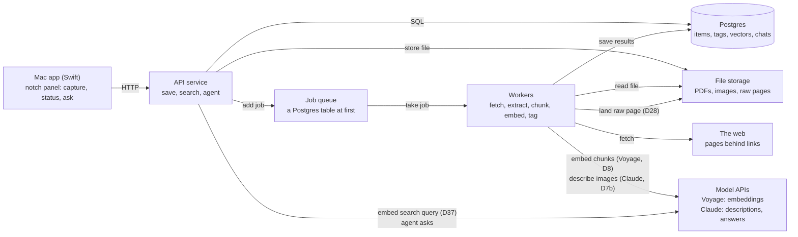

# Architecture: the components

> Read this when: you add or change a component, a connection between components, or wonder where some logic belongs.

The key idea: the API answers "Saved" at once and puts a job in a queue. Workers do the slow work later.

Platform under every box (the DevOps half): Docker, CI/CD, Terraform, secrets, logs, metrics and alerts.

| Component | Its one job | Analogy | Main concept it teaches |
| --- | --- | --- | --- |
| Mac app | Take input, show live status, chat | The shop counter | API contracts, live updates, native UI |
| API service | Check input, save, answer fast | The waiter who takes the order | HTTP design, validation, auth |
| Postgres | Keep the truth: items, tags, vectors, chats | A filing cabinet with an index | Schema design, indexes, migrations |
| File storage | Hold big files outside the database | The warehouse out back | Storage interfaces, size limits |
| Job queue | Hold slow work until a worker is free | The ticket rail in a kitchen | Async work, retries, idempotency |
| Workers | Fetch, extract, chunk, embed, tag | The cooks who read the tickets | Pipelines, failure handling, scaling |
| Model APIs | Turn text into vectors (Voyage) and images and questions into words (Claude), with the owner's keys (D8) | A translator you pay per word | External APIs, rate limits, cost caps |
| Agent (in the API) | Use search as a tool to answer | A librarian who looks things up | Tool loops, guardrails, evaluation |

The backend does not care what the client is. The Swift app is just one client of the API. A web or Windows client could come later without backend changes.
