# Milestones overview

> Read this when: you need the build order, the phase gates, or want to find a milestone file.

Ten milestones in three phases. CI comes first, so every later change is tested on every push.

```mermaid
flowchart LR
    subgraph P1["Phase 1: core on your Mac"]
        M0[M0 Skeleton, tests, CI] --> M1[M1 Save notes and links] --> M2[M2 Upload files] --> M3[M3 Queue and workers]
    end
    subgraph P2["Phase 2: make it smart"]
        M4[M4 Search and eval] --> M5[M5 Recall and discuss] --> M6[M6 Notch app, live status]
    end
    subgraph P3["Phase 3: run it for real"]
        M7[M7 Azure with Terraform] --> M8[M8 Observe and alert] --> M9[M9 Harden and open up]
    end
    M3 -- "Gate 1: a saved link is searchable" --> M4
    M6 -- "Gate 2: ask the panel, get cited answers" --> M7
```

Gate 3 (end of M9): live demo on Azure, an alert fires in a test, a restore drill passes, and a stranger can run it from the README.

## Milestone files

- [M0: Skeleton, tests, CI](m0-skeleton-tests-ci.md)
- [M1: Save notes and links](m1-save-notes-and-links.md)
- [M2: Upload files](m2-upload-files.md)
- [M3: Queue and workers](m3-queue-and-workers.md)
- [M4: Search and eval](m4-search-and-eval.md)
- [M5: Recall and discuss](m5-recall-and-discuss.md)
- [M6: Notch app and live status](m6-notch-app-and-live-status.md)
- [M7: Azure with Terraform](m7-azure-with-terraform.md)
- [M8: Observe and alert](m8-observe-and-alert.md)
- [M9: Harden and open up](m9-harden-and-open-up.md)
