# Database schema

> The source of truth is `backend/migrations/`. Update this diagram in the same PR as any new migration.

As of migration 011 (M5):

```mermaid
erDiagram
    items ||--o{ item_tags : "has"
    tags  ||--o{ item_tags : "labels"
    items ||--o{ fetches : "fetched as"
    items ||--o{ item_versions : "has history"
    fetches ||--o{ item_versions : "first seen in"
    items ||--o{ jobs : "processed by"
    items ||--o{ chunks : "cut into"
    item_versions |o--o{ chunks : "cut from"
    items ||--o| file_texts : "files: text read from"
    conversations ||--o{ messages : "holds"
    conversations |o--o{ model_usage : "paid for (SET NULL)"
    conversations |o--o{ ask_requests : "asked in (SET NULL)"

    items {
        bigint      id PK "identity"
        text        type "note | link | file"
        text        title "1-200 chars, optional"
        text        url "required for links, max 2048, unique per link"
        text        body "required for notes, 1-20000 chars"
        timestamptz created_at "default now()"
        text        sha256 "files only: hash of the bytes, unique per file"
        text        media_type "files only: application/pdf | image/png | image/jpeg"
        bigint      size_bytes "files only, > 0"
        text        filename "files only, 1-200 chars, optional"
    }
    fetches {
        bigint      id PK "identity, append-only"
        bigint      item_id FK "ON DELETE CASCADE"
        timestamptz fetched_at
        text        requested_url
        text        final_url "after redirects"
        smallint    http_status "100-599"
        text        content_type
        integer     byte_size ">= 0"
        text        sha256 "of the raw body"
        text        storage_key "raw/<item_id>/..."
    }
    item_versions {
        bigint      id PK "identity"
        bigint      item_id FK "ON DELETE CASCADE"
        bigint      fetch_id FK "ON DELETE CASCADE"
        timestamptz valid_from
        timestamptz valid_to "null while current"
        text        text "non-empty"
        text        text_sha256
    }
    jobs {
        bigint      id PK "identity"
        bigint      item_id FK "ON DELETE CASCADE"
        text        kind "process | rebuild | embed"
        text        status "queued | running | failed | done | dead"
        smallint    attempts "0-3, +1 when claimed"
        timestamptz run_after "not claimable before"
        timestamptz locked_until "the lease, while running"
        text        error "latest failure's reason"
        timestamptz created_at
        timestamptz updated_at
        timestamptz finished_at "set when done or dead"
    }
    chunks {
        bigint      id PK "identity"
        bigint      item_id FK "ON DELETE CASCADE"
        integer     chunk_index "0, 1, 2, ...; unique per item"
        integer     start_char "position in the source text"
        integer     end_char "> start_char"
        text        text "= source_text[start_char:end_char]"
        text        source_sha256 "of the whole source text"
        bigint      item_version_id FK "links only; ON DELETE SET NULL"
        integer     page "PDFs only: 1-based; null otherwise"
        vector      embedding "vector(1024); null until embedded (D8)"
        text        embedding_model "the model that made embedding"
        tsvector    text_tsv "generated from text: english words, stemmed (D37)"
        timestamptz created_at
    }
    file_texts {
        bigint      item_id PK, FK "ON DELETE CASCADE; files only"
        text        text "a PDF's pages, or an image's description"
        text        text_sha256
        text        file_sha256 "items.sha256 it was made from"
        integer_arr page_starts "PDFs: page n = text[start:end]"
        integer_arr page_ends "PDFs only"
        text        extractor "pypdf 7.1.1, or <model> (image description)"
        timestamptz created_at
    }
    tags {
        bigint id PK "identity"
        text   name UK "1-50 chars"
    }
    item_tags {
        bigint item_id PK, FK "ON DELETE CASCADE"
        bigint tag_id  PK, FK "ON DELETE CASCADE"
    }
    conversations {
        bigint      id PK "identity"
        text        title "1-200 chars; first question if not given"
        bigint      scope_item_id "Discuss: the item; NO foreign key (snapshot)"
        text        scope_item_title "as it was"
        integer     scope_start_char "the cited passage, by position"
        integer     scope_end_char "> scope_start_char"
        integer     scope_page "PDFs"
        text        scope_text "the passage as the owner saw it"
        jsonb       filters "POST /ask: type, from, to, tag"
        timestamptz created_at
        timestamptz updated_at
    }
    messages {
        bigint      id PK "identity"
        bigint      conversation_id FK "ON DELETE CASCADE"
        integer     seq "1, 2, ...; unique per conversation"
        text        role "user | assistant"
        text        text "display text; answers keep [c:id] markers"
        json        api_messages "exact API messages of the turn (json keeps key order)"
        jsonb       citations "snapshots: item, page, positions, quote"
        jsonb       invalid_citations "markers removed, with the reason"
        jsonb       sources "passages handed to the model this turn"
        boolean     grounded "assistant only"
        text        stop_reason
        boolean     incomplete "turn limit reached"
        text        model "the model that answered"
        jsonb       usage "this turn's tokens and estimated cost"
        timestamptz created_at
    }
    model_usage {
        bigint      id PK "identity"
        timestamptz created_at
        text        provider "anthropic | openai | voyage | fake"
        text        model "the model that served the call"
        text        purpose "answer | judge | describe | check | embed_documents | embed_query"
        integer     input_tokens
        integer     output_tokens
        integer     cache_creation_input_tokens
        integer     cache_read_input_tokens
        numeric     cost_usd "estimate from the price table (D39)"
        bigint      conversation_id FK "ON DELETE SET NULL"
    }
    ask_requests {
        bigint      id PK "identity"
        timestamptz created_at "the rate limit counts the last 60 s"
        bigint      conversation_id FK "ON DELETE SET NULL"
    }
    schema_migrations {
        text        version PK "001, 002, ..."
        text        name
        timestamptz applied_at
    }
```

## Rules the database enforces

| Rule | Why |
| --- | --- |
| `type` is `note`, `link` or `file` | Unknown types can't sneak in through a bug or a manual `INSERT`. |
| A link has a `url`; a note has a `body`; a file has `sha256`, `media_type` and `size_bytes` | The API checks this first; the database is the second layer. |
| Length limits on `title`, `url`, `body` | They match the API's 422 limits, so both layers agree. |
| Deleting an item deletes its `item_tags` rows | No dangling links to deleted items (`ON DELETE CASCADE`). |
| A link's `url` is unique (`items_link_url_key`, partial: links only) | No duplicate links. The database decides, so two saves at the same instant can't both win; the API answers `409 Conflict` with `Location` of the existing item. Notes may repeat. |
| A file's `sha256` is unique (`items_file_sha256_key`, partial: files only) | The same bytes are stored once, whatever the filename (D34). Same race-proof rule and `409` + `Location` as links. |
| `media_type` is PDF, PNG or JPEG | The API decides it from the file's first bytes; the database refuses anything else. |
| Deleting an item deletes its `fetches` and `item_versions` | `ON DELETE CASCADE`; the API then deletes the files in storage. |
| At most one current version per item (`item_versions_one_current`) | Two "current" texts would make "what does it say now?" ambiguous (D32). |
| At most one unfinished job per item (`jobs_one_open_per_item`, partial: `queued`, `running`, `failed`) | Two re-run clicks can't queue two jobs, and two workers never process one item at once (D6). `POST /items/{id}/process` answers `409`. |
| A job's `status` is one of five; a `running` job has a lease; `done` and `dead` have `finished_at`; a `dead` job has an `error` | The queue's states can't drift into nonsense through a bug (D6, D35). |
| `attempts` is 0 to 3 | A try counts when claimed, and 3 is the most (D35). |
| Deleting an item deletes its `jobs` and `chunks` | `ON DELETE CASCADE`. A worker holding a deleted item's job finds it gone and writes nothing. |
| A chunk's `(item_id, chunk_index)` is unique (`chunks_item_index_key`) | One set per item. A job replaces the whole set in one transaction with "done" (D30). |
| A chunk's `end_char > start_char` and its text is non-empty | Positions must point at real text, for citations (D36). |
| A chunk has an `embedding` exactly when it has an `embedding_model` (`chunks_embedding_has_model`) | Vectors from two models can't be compared, so every vector says which model made it (D8). |
| `embedding` is `vector(1024)` | Postgres refuses a vector of any other length, so a wrong model setting fails loudly instead of storing vectors search can't use. |
| A chunk's `page` is 1 or more | Page numbers count from 1, like the PDF viewer (D7b). |
| One `file_texts` row per file item; its page arrays are both null or the same length | Chunks point into one text. It is written in the same transaction as the chunks (D30), and rebuilt from the stored file when asked. |
| Deleting an item deletes its `file_texts` | `ON DELETE CASCADE`; the API then deletes the stored file. |
| `tags.name` is unique | One row per tag name; items share it. |
| `chunks.text_tsv` is `GENERATED ALWAYS AS (to_tsvector('english', text)) STORED` | Postgres recomputes it whenever `text` changes, so the words search matches can never disagree with the chunk (D37). |
| `conversations.scope_item_id` has no foreign key | Deleting an item must not delete the chats about it. The chat stays readable (each answer keeps its citation snapshots); the API refuses new messages in it (409). Item ids are never reused, so a missing `items` row means deleted. |
| A conversation's passage has an item, and `scope_end_char > scope_start_char` with its `scope_text` | The passage is kept by position, so it survives re-chunking (D36); the text is what the owner clicked. |
| A message's `(conversation_id, seq)` is unique | One order per conversation. A message and its answer are saved together; a second answer racing in the same conversation loses (409), so history never forks (D21). |
| `messages.api_messages` is `json`, not `jsonb` | `json` keeps the text exactly, key order included; the next request replays it unchanged (D21). |
| An assistant message has `grounded` and `incomplete` | Every answer says whether it is backed by a valid citation (D38) and whether the turn limit cut it short (D9). |
| Deleting a conversation deletes its `messages`; its `model_usage` and `ask_requests` rows stay (`ON DELETE SET NULL`) | The money was spent, and the questions were asked (D39). |
| `model_usage` token counts and `cost_usd` are 0 or more | A row is one model call (D39). |

## Indexes

| Index | Serves |
| --- | --- |
| `items` primary key | `GET /items/{id}` and newest-first paging (`ORDER BY id DESC`, `id < before`) |
| `items_link_url_key` (unique, `WHERE type = 'link'`) | Duplicate-link rule; also fast "is this URL saved?" lookups |
| `items_file_sha256_key` (unique, `WHERE type = 'file'`) | Duplicate-file rule; also the 409's "which item holds these bytes?" lookup |
| `fetches_item_time_idx` `(item_id, fetched_at)` | An item's fetches in order, and its latest fetch |
| `item_versions_item_from_idx` `(item_id, valid_from)` | Point-in-time reads (`?as_of=`) |
| `jobs_due_idx` on `(CASE WHEN status = 'running' THEN locked_until ELSE run_after END, id)`, partial: unfinished | The claim query: the oldest due job, skipping locked ones. The query uses the same expression, so it reads the index. |
| `jobs_one_open_per_item` (unique, partial) | The one-unfinished-job rule, and the `ON CONFLICT` in `jobs.enqueue` |
| `jobs_item_idx` `(item_id, id)` | An item's latest job: its processing state in `GET /items` |
| `chunks_item_index_key` `(item_id, chunk_index)` | An item's chunks in order (`GET /items/{id}/chunks`) |
| `file_texts` primary key `(item_id)` | A file's text (`GET /items/{id}/text`) |
| `item_tags` primary key `(item_id, tag_id)` | Tags of one item |
| `item_tags_tag_id_idx` | Items with one tag (the search `tag` filter) |
| `chunks_text_tsv_idx` (GIN on `text_tsv`) | Keyword search: `text_tsv @@` the query from `websearch_to_tsquery('english', q)`; in keyword mode also its any-word form (every ` & ` turned into ` \| `); in hybrid mode also the typed codes (the query's lexemes with a digit, OR-joined) (D37) |
| `messages_conversation_seq_key` `(conversation_id, seq)` | A conversation's messages in order: the history replay and `GET /conversations/{id}` |
| `model_usage_created_at_idx` | Today's total for the cost cap, and `GET /usage` (D39) |
| `ask_requests_created_at_idx` | The rate limit: questions in the last 60 seconds (D39) |
| `chunks_embedding_hnsw_idx` (HNSW, `vector_cosine_ops`) | Vector search with no filter: the nearest chunks by cosine distance (`<=>`). Approximate; under a filter, search measures the filtered rows exactly instead, so a filter can't lose a match (D37). |

Tags (M4): `PUT /items/{id}/tags` replaces an item's set. Names are normalised one way (trimmed, inner whitespace squeezed to one space, lowercased); unused tag rows stay as the owner's vocabulary.

`schema_migrations` is created by the migration runner (`mind_dump.migrate`), not by a migration file.

## Processing state (P3)

`items` no longer has a `status` column (migration 007 dropped it; it was always `saved`).
The API derives each item's `status` from its latest job:

| Latest job | Item `status` | `error` |
| --- | --- | --- |
| none (should not happen: every item gets a job when saved) | `saved` | none |
| `queued` | `queued` | none |
| `running` | `processing` | none |
| `failed` | `retrying` | the failure's reason |
| `done` | `ready` | none |
| `dead` | `error` | why it gave up |

Migration 007 also queued one job for every note and link saved before it, so the worker catches them up. Migration 009 did the same for files (M3), and added the job kind `embed`: embed an item's existing chunks with no fetch and no re-chunking (queued by `python -m mind_dump.embed_missing`).
