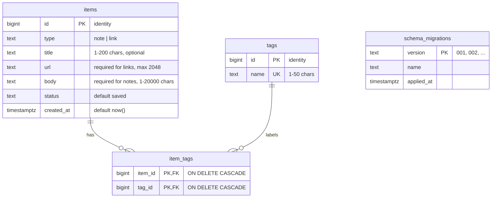

# Database schema

> The source of truth is `backend/migrations/`. Update this diagram in the same PR as any new migration.

As of migration 002 (M1):

## Rules the database enforces

| Rule | Why |
| --- | --- |
| `type` is `note` or `link` | Unknown types can't sneak in through a bug or a manual `INSERT`. |
| A link has a `url`; a note has a `body` | The API checks this first; the database is the second layer. |
| Length limits on `title`, `url`, `body` | They match the API's 422 limits, so both layers agree. |
| Deleting an item deletes its `item_tags` rows | No dangling links to deleted items (`ON DELETE CASCADE`). |
| `tags.name` is unique | One row per tag name; items share it. |

## Indexes

| Index | Serves |
| --- | --- |
| `items` primary key | `GET /items/{id}` and newest-first paging (`ORDER BY id DESC`, `id < before`) |
| `item_tags` primary key `(item_id, tag_id)` | Tags of one item |
| `item_tags_tag_id_idx` | Items with one tag |

`schema_migrations` is created by the migration runner (`mind_dump.migrate`), not by a migration file.
