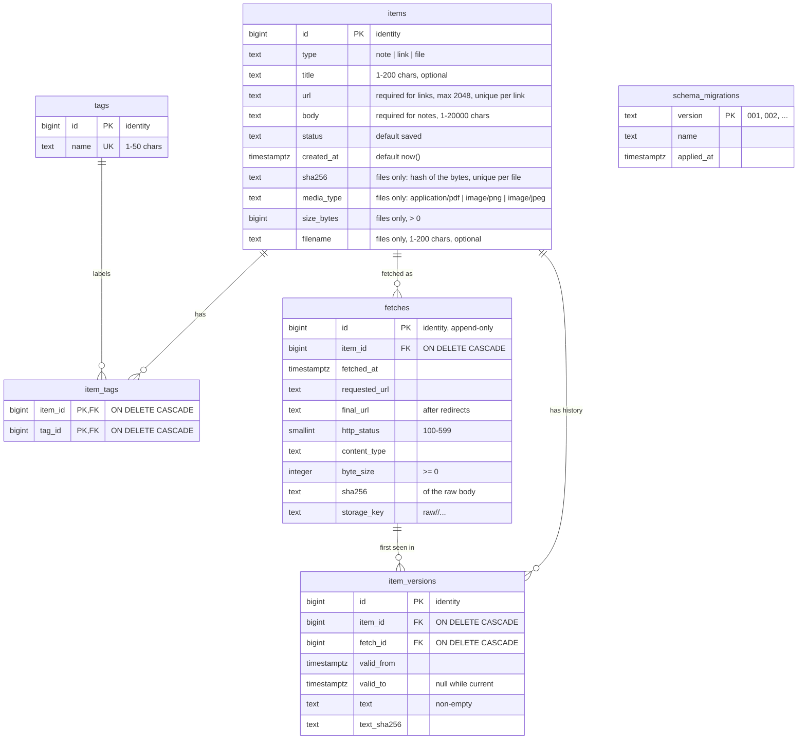

# Database schema

> The source of truth is `backend/migrations/`. Update this diagram in the same PR as any new migration.

As of migration 006 (P2):

## Rules the database enforces

| Rule | Why |
| --- | --- |
| `type` is `note`, `link` or `file` | Unknown types can't sneak in through a bug or a manual `INSERT`. |
| A link has a `url`; a note has a `body`; a file has `sha256`, `media_type` and `size_bytes` | The API checks this first; the database is the second layer. |
| Length limits on `title`, `url`, `body` | They match the API's 422 limits, so both layers agree. |
| Deleting an item deletes its `item_tags` rows | No dangling links to deleted items (`ON DELETE CASCADE`). |
| A link's `url` is unique (`items_link_url_key`, partial: links only) | No duplicate links. The database decides, so two saves at the same instant can't both win; the API answers `409 Conflict` with `Location` of the existing item. Notes may repeat. |
| A file's `sha256` is unique (`items_file_sha256_key`, partial: files only) | The same bytes are stored once, whatever the filename (D34). Same race-proof rule and `409` + `Location` as links. |
| `media_type` is PDF, PNG or JPEG | The API decides it from the file's first bytes; the database refuses anything else. |
| Deleting an item deletes its `fetches` and `item_versions` | `ON DELETE CASCADE`; the API then deletes the files in storage. |
| At most one current version per item (`item_versions_one_current`) | Two "current" texts would make "what does it say now?" ambiguous (D32). |
| `tags.name` is unique | One row per tag name; items share it. |

## Indexes

| Index | Serves |
| --- | --- |
| `items` primary key | `GET /items/{id}` and newest-first paging (`ORDER BY id DESC`, `id < before`) |
| `items_link_url_key` (unique, `WHERE type = 'link'`) | Duplicate-link rule; also fast "is this URL saved?" lookups |
| `items_file_sha256_key` (unique, `WHERE type = 'file'`) | Duplicate-file rule; also the 409's "which item holds these bytes?" lookup |
| `fetches_item_time_idx` `(item_id, fetched_at)` | An item's fetches in order, and its latest fetch |
| `item_versions_item_from_idx` `(item_id, valid_from)` | Point-in-time reads (`?as_of=`) |
| `item_tags` primary key `(item_id, tag_id)` | Tags of one item |
| `item_tags_tag_id_idx` | Items with one tag |

`schema_migrations` is created by the migration runner (`mind_dump.migrate`), not by a migration file.
